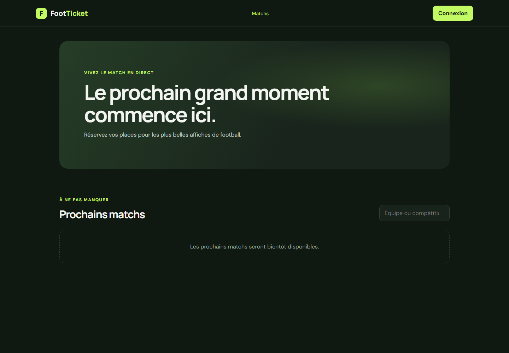

# FootTicket

Application de billetterie football avec une API Express/Mongoose et une interface React/Vite.

## Capture d'écran

## Démarrage local

1. Installer les dépendances dans `backend` et `frontend` avec `npm install`.
2. Copier `.env.example` vers `backend/.env`, définir une valeur secrète pour `JWT_SECRET`, puis démarrer MongoDB.
3. Dans `backend`, lancer `npm run dev`.
4. Dans `frontend`, lancer `npm run dev`.

L'API est disponible sur `http://localhost:5000/api` et le client Vite sur `http://localhost:5173`.

## Routes initiales

- `POST /api/auth/register` et `POST /api/auth/login`
- `GET /api/auth/me` avec un jeton Bearer
- `GET /api/matches` avec les filtres facultatifs `q`, `competition`, `from` et `to`
- `GET /api/matches/:id`
- `POST /api/matches`, `PATCH /api/matches/:id` et `DELETE /api/matches/:id` (administrateur)

Le rôle `admin` n'est jamais attribué par l'inscription publique. Créer le premier administrateur par une opération locale contrôlée ou une procédure d'administration protégée.
